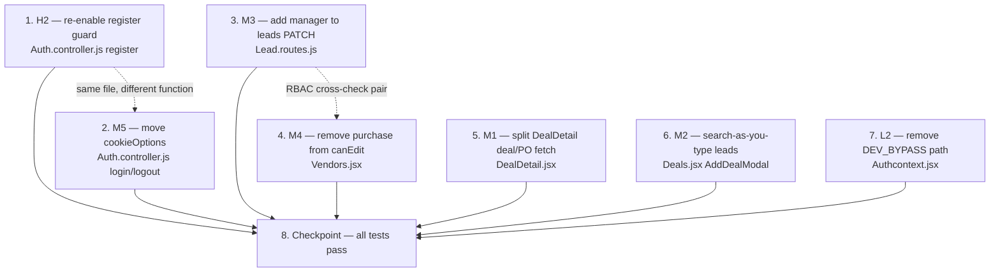

# Implementation Plan

## Overview

This plan implements the seven in-scope audit findings (H2, M1, M2, M3, M4, M5, L2) for the SourceUpCRM stack (Node/Express + MongoDB backend, React/Vite frontend). Each bug is exactly one independently completable task with its concrete file edit(s) and regression-prevention acceptance checks (a task is "completed" only when the preserved behaviors are verified, not just when the edit is made).

The bugs are grouped by area and ordered so the backend RBAC change (M3) is immediately followed by its frontend counterpart (M4) for an explicit cross-check. H2 and M5 share `Auth.controller.js` (different functions) and are grouped together; the two behavior-preserving refactors (M5, L2) keep runtime behavior byte-for-byte identical.

Out of scope (no tasks): H1 (already fixed), C1/C2/C3 (already fixed in a prior pass), H3/L3/L4/L5 (no actual bug), L1 (two API envelopes — larger refactor, known follow-up only).

## Notes

- **H1 guardrail — DO NOT MODIFY `Vendor.controller.js` AuditLog calls.** H1 (Vendor AuditLog `performedBy` → `userId`) is already fixed in the codebase: `Vendor.controller.js` already calls `AuditLog.create({ userId: req.user._id, ... })` in all three places and `performedBy` no longer exists anywhere in the backend. None of the tasks below touch `Vendor.controller.js`. This guardrail exists so the already-correct code is not regressed.
- **RBAC consistency rule (M3/M4).** Frontend permission expressions and backend `requireRole` arrays MUST describe the same set of allowed roles, so the UI never renders an action the API will reject with a guaranteed 403. The acceptance gate for M3/M4 is "frontend permission expression == backend `requireRole` set". After this sweep the allowed-edit sets are: leads PATCH = `{sales, manager, superadmin}` (matches deals PATCH); vendors PATCH (backend) = `{manager, superadmin}` and Vendors `canEdit` (frontend) = `{manager, superadmin}`.
- **No new dependencies (M2).** M2 reuses the existing `useRef` + `setTimeout(350)` debounce + `PortalDropdown` + `getLeads({ search })` pattern already present in the list pages. No new library is introduced.
- **Behavior-preserving refactors (M5/L2).** These change code structure only; runtime behavior must be byte-for-byte identical to the current behavior. Their acceptance gate is `F(input) = F'(input)` over the full domain.

## Tasks

- [ ] 1. H2 — Re-enable the registration guard in `register` (Auth security)

  **File**: `Backend/Controllers/Auth.controller.js`
  **Function**: `register`
  **Design section**: "H2 — Re-enable the registration guard"
  **Requirements**: 2.1 (expected), 3.1 / 3.2 / 3.3 (unchanged) · **Design Properties**: Property 1 (bug condition), Property 2 (preservation)

  Current defect: `role: "superadmin"` is hardcoded for every registration and the `existingUsers > 0` bootstrap guard is commented out, so anyone who discovers `/api/v1/auth/register` can self-create a superadmin account (Requirements 1.1).

  Concrete changes:
  - Remove the commented-out guard and its dev/TODO comment (the `// Allow multiple superadmin accounts during development.` / `TODO: re-enable this check before production deployment.` lines and the commented `if (existingUsers > 0) { ... }` block currently sitting between the empty-field check and the `ValidPassword`/`ValidUserName`/`ValidEmail` validation).
  - Move `const existingUsers = await User.countDocuments();` and a re-enabled guard to sit AFTER the `ValidPassword`/`ValidUserName`/`ValidEmail` validation block and BEFORE `User.create`. Placing it after format validation means invalid input still surfaces its `400` validation error first (preserves 3.2) and the DB count is only paid for valid input.
  - Re-enable the guard so a populated DB rejects registration: `if (existingUsers > 0) throw new ApiError(403, "Registration is closed. Ask a SuperAdmin to create your account.");`
  - Keep `role: "superadmin"` in `User.create` (correct for the bootstrap user, which is now the only user this handler can create).
  - Add a one-line clarifying comment above the guard, e.g. `// Bootstrap-only: the first user becomes superadmin; further accounts are created by a superadmin via /users.`

  Acceptance checks (task is completed only when all pass):
  - **Bug-condition check (Property 1 / 2.1)**: seed one user, `POST /api/v1/auth/register` with a valid body → MUST return `403 "Registration is closed…"` and MUST NOT create a user. (Before the fix this creates a new superadmin — that is the bug being confirmed.)
  - **Preservation — bootstrap (Property 2 / 3.1)**: empty DB, same valid request → MUST still create the first `superadmin` and return it (`201`).
  - **Preservation — validation (Property 2 / 3.2)**: invalid body (empty fields, invalid email/username/password) → MUST still return the existing `400` validation error and MUST NOT create a user.
  - **Preservation — AuditLog (Property 2 / 3.3)**: a successful bootstrap registration MUST still write the `AuditLog` `REGISTER` entry.
  - Verify the validation order is preserved (empty-field check, then format validation, then the guard) so invalid input never pays the DB count or triggers the 403.

---

- [ ] 2. M5 — Move `cookieOptions` above the response with correct indentation (Auth maintainability)

  **File**: `Backend/Controllers/Auth.controller.js`
  **Functions**: `login`, `logout`
  **Design section**: "M5 — Move `cookieOptions` above the response with correct indentation"
  **Requirements**: 2.6 (expected), 3.11 / 3.12 (unchanged) · **Design Properties**: Property 11 (bug condition), Property 12 (preservation)

  Current defect: `cookieOptions` is declared mid-handler with misaligned indentation (a cut-paste artifact) in both `login` (declared after the bcrypt compare, body/closing-brace mis-indented) and `logout` (declared after the AuditLog, at column 0). Functionally harmless today but a maintainability risk (Requirements 1.6).

  Concrete changes:
  - In `login`: move the `const cookieOptions = { httpOnly: true, secure: process.env.NODE_ENV === "production", sameSite: process.env.NODE_ENV === "production" ? "none" : "lax" };` declaration to the top of the handler — right after the destructuring/empty-field guard, before `User.findOne` — with correct 2-space indentation matching the file style.
  - In `logout`: move the same declaration to the top of the handler — right after the handler opens, before `User.findByIdAndUpdate` — with correct indentation.
  - Keep the object values byte-identical (`httpOnly`, `secure`, `sameSite` all unchanged).
  - Do NOT move or alter the `.cookie()`/`.clearCookie()` calls or the `AuditLog` `LOGIN`/`LOGOUT` writes; they stay exactly where they are.

  Acceptance checks (task is completed only when all pass):
  - **Bug-condition check (Property 11 / 2.6)**: read `login`/`logout` and confirm `cookieOptions` is now declared cleanly above the cookie response with correct indentation (before the fix it was mid-handler with misaligned indentation — that structural defect is gone).
  - **Preservation — identical cookies (Property 12 / 3.11)**: login/logout MUST still set/clear `accessToken` and `refreshToken` with the same `httpOnly`/`secure`/`sameSite` attributes and return the same responses. (Diff the handler output before/after the move — positional + indentation only.)
  - **Preservation — AuditLog (Property 12 / 3.12)**: the `LOGIN`/`LOGOUT` `AuditLog` entries MUST still be written.

---

- [ ] 3. M3 — Add `manager` to the leads PATCH route (Lead RBAC)

  **File**: `Backend/Routes/Lead.routes.js`
  **Route**: `PATCH /:id` (currently `requireRole("sales", "superadmin")`, `updateLead`)
  **Design section**: "M3 — Add `manager` to the leads PATCH route"
  **Requirements**: 2.4 (expected), 3.7 / 3.8 (unchanged) · **Design Properties**: Property 7 (bug condition), Property 8 (preservation)

  Current defect: `PATCH /api/v1/leads/:id` permits only `sales` and `superadmin`; `manager` (who can edit deals) is excluded — an inconsistency (Requirements 1.4).

  Concrete changes:
  - Change `PATCH /:id` from `.patch(requireRole("sales", "superadmin"), updateLead)` to `.patch(requireRole("sales", "manager", "superadmin"), updateLead)`, matching `Deal.routes.js` `PATCH /:id` (`requireRole("sales", "manager", "superadmin")`) exactly. One-token edit; `requireRole` is variadic and already used this way.
  - Do NOT touch the GET/POST/notes/history routes for leads (3.8).

  Acceptance checks (task is completed only when all pass):
  - **Bug-condition check (Property 7 / 2.4)**: as `manager`, `PATCH /api/v1/leads/:id` → MUST return `200` (update applied). (Before the fix this returns `403` — that is the bug being confirmed.)
  - **Preservation — other roles (Property 8 / 3.7)**: `sales`/`superadmin` MUST still be accepted (`200`); `purchase` (and any other role) MUST still be rejected with `403`.
  - **Preservation — other operations (Property 8 / 3.8)**: lead view/create/notes/history permissions MUST remain unchanged (verify the other `requireRole` arrays in `Lead.routes.js` are untouched).
  - **RBAC cross-check (shared rule)**: confirm leads PATCH roles `{sales, manager, superadmin}` equal deals PATCH roles `{sales, manager, superadmin}` in `Deal.routes.js`.
  - **H1 guardrail**: this task edits a routes file only — do NOT touch `Vendor.controller.js` AuditLog calls.

---

- [ ] 4. M4 — Remove `purchase` from the Vendors `canEdit` (Vendor RBAC)

  **File**: `Frontend/src/Pages/Vendors.jsx` (`canEdit`, ~line 692)
  **Do NOT change**: `Backend/Routes/Vendor.routes.js` (PATCH already permits `manager`/`superadmin` only), `canCreate` in `Vendors.jsx`
  **Design section**: "M4 — Remove `purchase` from the Vendors `canEdit`"
  **Requirements**: 2.5 (expected), 3.9 / 3.10 (unchanged) · **Design Properties**: Property 9 (bug condition), Property 10 (preservation)

  Current defect: `canEdit` includes `"purchase"` so the Edit button renders, but the PATCH route allows only `manager`/`superadmin`, so a purchase user gets a guaranteed 403 (Requirements 1.5).

  Concrete changes:
  - Change `canEdit` from `user?.role === "manager" || user?.role === "superadmin" || user?.role === "purchase"` to `user?.role === "manager" || user?.role === "superadmin"`. This matches `Vendor.routes.js` `PATCH /:id` (`requireRole("manager", "superadmin")`), so a `purchase` user no longer sees an Edit button that would 403.
  - Do NOT touch `canCreate` (it includes `"purchase"` and is a separate permission — 3.10 requires it unchanged).
  - Do NOT touch the backend route under the recommended option (it already rejects `purchase`).

  Acceptance checks (task is completed only when all pass):
  - **Bug-condition check (Property 9 / 2.5)**: render the Vendors page as a `purchase` user → the Edit button MUST NOT be offered (no UI that leads to a guaranteed 403). (Before the fix the button renders and the PATCH 403s — that is the bug being confirmed.)
  - **Preservation — allowed editors (Property 10 / 3.9)**: `manager`/`superadmin` MUST still be able to edit vendors (Edit button renders, PATCH `200`); `sales`/`purchase` MUST still be rejected with `403` (backend route untouched).
  - **Preservation — canCreate (Property 10 / 3.10)**: `canCreate` behavior MUST remain unchanged (it still includes `purchase`).
  - **RBAC cross-check (shared rule)**: confirm Vendors `canEdit` `{manager, superadmin}` equals `Vendor.routes.js` PATCH roles `{manager, superadmin}`, AND confirm leads PATCH `{sales, manager, superadmin}` (task 3) still matches deals PATCH `{sales, manager, superadmin}`. If a role is added to one side it MUST be added to the other.
  - **H1 guardrail**: this task edits `Vendors.jsx` only — do NOT touch `Vendor.controller.js` (or `Vendor.routes.js`) AuditLog calls.

---

- [ ] 5. M1 — Split the DealDetail deal/PO fetch with a dedicated PO error state (Deal UX)

  **File**: `Frontend/src/Pages/DealDetail.jsx` (load `useEffect` ~line 282, and component state/render)
  **Design section**: "M1 — Split the DealDetail deal/PO fetch with a dedicated PO error state"
  **Requirements**: 2.2 (expected), 3.4 / 3.5 (unchanged) · **Design Properties**: Property 3 (bug condition), Property 4 (preservation)

  Current defect: the shared `.catch` checks `if (!deal)`, but `deal` is `null` in the stale closure, so the condition is always true and any linked-PO fetch error is misreported as "Deal not found" (Requirements 1.2).

  Concrete changes:
  - Add a `poError` state: `const [poError, setPoError] = useState("");` alongside the existing `error` state.
  - Split the single load effect into two:
    - **Deal effect** (keeps `loading`/not-found): `getDealById(id).then(res => setDeal(res.data.data)).catch(err => setError(err.response?.data?.message || "Deal not found")).finally(() => setLoading(false))`. Dependency: `[id]`.
    - **PO effect**: depends on `deal` so it only runs once the deal exists — `if (!deal) return; getPOs({ dealId: id }).then(poRes => { if (poRes?.data?.data?.purchases) setLinkedPOs(poRes.data.data.purchases); }).catch(() => setPoError("Could not load linked POs"))`. Dependency: `[id, deal]`. Gating on `deal` means a missing deal never triggers a spurious PO error (preserves 3.4).
  - Remove the stale `if (!deal)` gate from the old shared `.catch` (the old `.catch` is removed entirely). The deal-not-found message now comes only from the deal effect's `setError` (3.4); the PO error goes to the separate `poError` state (2.2).
  - Render `poError` as a non-fatal inline banner in the linked-POs area (NOT the full-page `error || !deal` guard, which stays unchanged for the not-found case). This lets the deal render while surfacing the PO failure.
  - Clear `poError` at the start of the PO effect (e.g., `setPoError("")`) so stale errors don't linger across navigation.

  Acceptance checks (task is completed only when all pass):
  - **Bug-condition check (Property 3 / 2.2)**: deal fetch resolves but linked-PO fetch rejects → the page MUST surface the PO-fetch error ("Could not load linked POs") WITHOUT reporting "Deal not found", and the deal MUST still render. (Before the fix the page shows "Deal not found" — that is the bug being confirmed.)
  - **Preservation — deal not found (Property 4 / 3.4)**: deal fetch itself fails (genuinely missing deal) → the deal-not-found state MUST still show (PO effect returns early because `deal` is null, so no spurious PO error).
  - **Preservation — success (Property 4 / 3.5)**: both deal and PO fetches succeed → the deal and its linked POs MUST render as before, with `poError` empty.

---

- [ ] 6. M2 — Search-as-you-type lead filter in the Add Deal modal (Deal UX)

  **File**: `Frontend/src/Pages/Deals.jsx` (`AddDealModal` lead fetch effect ~line 74, lead `PortalDropdown` ~line 162)
  **Component unchanged**: `Frontend/src/components/PortalDropdown.jsx`
  **Design section**: "M2 — Search-as-you-type lead filter in Add Deal"
  **Requirements**: 2.3 (expected), 3.6 (unchanged) · **Design Properties**: Property 5 (bug condition), Property 6 (preservation)

  Current defect: the lead dropdown fetches `getLeads({ limit: 100 })` and the backend caps `limit` at 100 (`Math.min(100, ...)`); with more than 100 leads the dropdown silently truncates and leads become unselectable (Requirements 1.3).

  Concrete changes (reuse the existing list-page debounce pattern at `searchTimer`/`debouncedSearch` ~lines 308–315):
  - Add search state: `const [leadSearch, setLeadSearch] = useState("");` and `const [debouncedLeadSearch, setDebouncedLeadSearch] = useState("");`.
  - Add a debounce effect mirroring the Deals/Vendors pattern: a `useRef` timer that sets `debouncedLeadSearch` from `leadSearch` after 350ms, clearing on cleanup.
  - Replace the single mount fetch (`getLeads({ limit: 100 })`) with a fetch keyed on `debouncedLeadSearch`: `getLeads({ search: debouncedLeadSearch, limit: 100 })` → map to the same `{ value, label, clientName }` shape → `setLeads(...)`. On mount (empty search) this returns the first page so the user sees options immediately (3.6).
  - Add a search input above the existing `PortalDropdown`, consistent with the list-page filter bars: a text input with the `Search` icon and `input-glass` styling (matching the Deals filter bar — `Search size={14}` + `input-glass` + `paddingLeft: 36, height: 38, fontSize: 13`) bound to `leadSearch`. The existing `PortalDropdown` component is unchanged and still receives the fetched `leads` as `options` and `form.leadId` as `value`.
  - Add `leadsLoading` handling (the `leadsLoading` state already exists ~line 70) and an empty-state: while loading show "Loading leads…"; when the search returns no results show "No leads found".
  - Keep the auto-fill behavior unchanged: `setV("leadId")` still does `leads.find(l => l.value === v)` and sets `customerName` (3.6). Because the selected lead is present in the fetched `leads` for the current search, the find still resolves.

  Acceptance checks (task is completed only when all pass):
  - **Bug-condition check (Property 5 / 2.3)**: with >100 leads, open Add Deal, type a search, and select a lead beyond the first 100 → MUST be findable and selectable with no silent truncation. (Before the fix lead #101+ is absent from the dropdown — that is the bug being confirmed.)
  - **Preservation — small set + auto-fill (Property 6 / 3.6)**: with ≤100 leads and no search term, the dropdown MUST still populate (initial empty-search fetch reproduces today's behavior) and the customer name MUST still auto-fill from the selected lead.
  - Verify no new dependency is introduced (the debounce reuses `useRef` + `setTimeout`, the dropdown reuses `PortalDropdown`, and the search reuses the existing `getLeads({ search })` backend param).

---

- [ ] 7. L2 — Remove the dead `DEV_BYPASS` path (Frontend auth cleanup)

  **File**: `Frontend/src/context/Authcontext.jsx`
  **Component**: `AuthProvider`
  **Design section**: "L2 — Remove the dead `DEV_BYPASS` path"
  **Requirements**: 2.7 (expected), 3.13 / 3.14 (unchanged) · **Design Properties**: Property 13 (bug condition), Property 14 (preservation)

  Current defect: the dead `DEV_BYPASS = false` block + `DEV_USER` mock + bypass ternaries ship in production (a dormant superadmin-bypass path), even though the real flow already runs because the constant is `false` (Requirements 1.7).

  Concrete changes:
  - Delete the dev-bypass block: remove the `// ─── DEV BYPASS ───` comment, `const DEV_BYPASS = false;`, the `DEV_USER = { ... }` mock, and the trailing comment line.
  - Remove the ternaries/usages: `useState(DEV_BYPASS ? DEV_USER : null)` → `useState(null)`; `useState(!DEV_BYPASS)` → `useState(true)`; inside the `useEffect`, remove the `if (DEV_BYPASS) return; // skip API call in dev bypass mode` line.
  - Leave the real flow untouched: the `wakeTimer`/`getCurrentUser().then(setUser).catch(() => setUser(null)).finally(...)` logic and the `login`/`logout` functions remain exactly as they are.

  Acceptance checks (task is completed only when all pass):
  - **Bug-condition check (Property 13 / 2.7)**: read `Authcontext.jsx` and confirm no `DEV_BYPASS`/`DEV_USER` references remain; the provider always runs the real auth flow. (Before the fix the dormant bypass path is present — that structural defect is gone.)
  - **Preservation — identical runtime (Property 14 / 3.13, 3.14)**: an unauthenticated user MUST still call `getCurrentUser`, set `null` on failure, and show the login flow; login/logout MUST still use the real `LoginUser`/`LogoutUser` calls and update user state. Because every removed expression evaluated to the value the real path already uses (`DEV_BYPASS` was `false`), runtime behavior is identical.

---

- [ ] 8. Checkpoint — Ensure all tests pass

  - Run the project's build/lint and the relevant test commands for the backend (Express) and frontend (Vite/React).
  - Confirm every bug-condition acceptance check from tasks 1–7 now PASSES on the fixed code (bugs resolved) and every preservation acceptance check still PASSES (no regressions).
  - Confirm the RBAC cross-check holds end-to-end: leads PATCH `{sales, manager, superadmin}` == deals PATCH `{sales, manager, superadmin}`; Vendors `canEdit` `{manager, superadmin}` == `Vendor.routes.js` PATCH `{manager, superadmin}`.
  - Confirm the H1 guardrail held: `Vendor.controller.js` AuditLog calls were not touched and still use `userId`.
  - Ask the user if any questions arise; do not mark the sweep complete until all preserved behaviors are verified, not just until edits are made.

## Task Dependency Graph

The seven bug tasks are independent edits (one file/area each) and can be implemented in parallel. The only hard dependency is the final checkpoint, which depends on all bug tasks. Soft dependencies (recommended ordering, not blocking) exist where two tasks share a file or form a cross-check pair.

```json
{
  "waves": [
    {
      "wave": 1,
      "description": "Independent bug fixes — one task per bug, no inter-task hard dependencies",
      "tasks": [1, 2, 3, 4, 5, 6, 7],
      "dependsOn": []
    },
    {
      "wave": 2,
      "description": "Final checkpoint — depends on all bug tasks being complete and verified",
      "tasks": [8],
      "dependsOn": [1, 2, 3, 4, 5, 6, 7]
    }
  ]
}
```



Dependency notes:
- Tasks 1–7 are independent; none blocks another. The dotted edges are soft/co-ordination hints, not hard dependencies.
- Tasks 1 and 2 both edit `Backend/Controllers/Auth.controller.js` (different functions: `register` vs `login`/`logout`). Do them together to avoid merge churn; order does not matter.
- Tasks 3 and 4 form the RBAC cross-check pair: M3 (leads PATCH backend) must be verified against M4 (Vendors `canEdit` frontend) — implement M3 first, then M4, then run the shared cross-check in task 4 and the final checkpoint.
- Task 8 (checkpoint) is the only hard dependency: it depends on all of tasks 1–7 being complete and verified.

