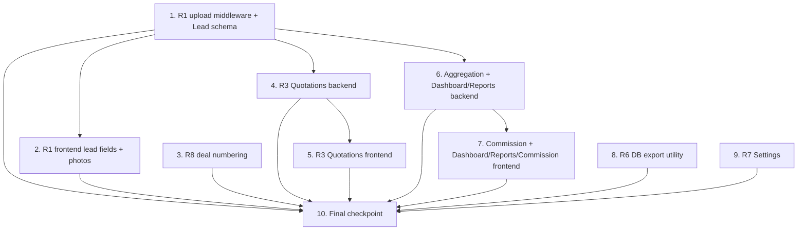

# Implementation Plan

## Overview

This plan implements the v1 completion backlog (requirements.md R1-R8 and design.md). Tasks are grouped by feature; each lists files to create/modify, concrete steps, and acceptance checks. Order follows dependencies: shared utilities/schema first, then backend modules, then frontend pages. After any code-changing task, run backend node --check and frontend vite build.

## Notes

- Backend conventions: AsyncHandler, ApiError/ApiResponse, AuditLog on mutating actions, VerifyJWT + requireRole on routes, scopeFilter for sales users.
- Frontend conventions: glass UI, PortalDropdown/EditField, the axios instance with credentials, and the useRef debounce pattern.
- No new runtime dependencies (multer is already installed).
- Register every new router in Backend/app.js.

## Tasks

- [x] 1. R1 upload middleware + Lead schema enrichment fields
  Files: Backend/Middleware/MulterImages.middleware.js (new); Backend/MongoDB/Models/Lead.schema.js, Backend/Controllers/Lead.controller.js, Backend/Routes/Lead.routes.js (modify).
  Steps:
  - Create MulterImages.middleware.js: diskStorage to public/uploads/leads, image MIME filter (jpg/jpeg/png/webp), 5MB limit; export uploadLeadPhoto (single field "photo").
  - Add packingDetails (String), moq (Number), cbp (Number), targetPrice (Number), photos ([String]) to Lead.schema.js.
  - In Lead.controller.js createLead/updateLead: accept the four scalar fields; add uploadLeadPhoto (push filename to photos) and removeLeadPhoto (delete file + splice array).
  - In Lead.routes.js: POST /:id/photos (uploadLeadPhoto) and DELETE /:id/photos/:index (removeLeadPhoto); requireRole sales/manager/superadmin.
  Acceptance: node --check passes; a photo upload stores a file and adds to photos; removal deletes both; the four scalar fields persist via PATCH.

- [x] 2. R1 frontend lead fields + photo UI
  Files: Frontend/src/components/PhotoUpload.jsx (new); Frontend/src/api/leadsApi.js, Frontend/src/Pages/Leads.jsx, Frontend/src/Pages/LeadDetail.jsx (modify).
  Steps:
  - Create PhotoUpload.jsx (props photos/canEdit/onUpload/onRemove; thumbnail grid + remove).
  - leadsApi.js: add uploadLeadPhoto, removeLeadPhoto; include the new fields in create/update payloads.
  - Leads.jsx: add form inputs for packingDetails, moq, cbp, targetPrice.
  - LeadDetail.jsx: EditField rows for the four fields + the PhotoUpload component.
  Acceptance: vite build passes; fields round-trip; photos upload/preview/remove in UI.

- [x] 3. R8 service-prefix-aware deal numbering
  Files: Backend/Utils/generateId.js, Backend/Controllers/Deal.controller.js (modify).
  Steps:
  - generateId.js: add generateDealId(serviceType) resolving an active ServicePrefix code (Sourcing->SRC, Packaging->PKG, Website & IT->WEB, Social Media->SMM, Legal->LEG, Investment->INV, Consultancy->CON) and calling generateId("deal-" + code, "SUI-D-" + code); fallback generateId("deal", "SUI-D"). Also add generateQuotationId() -> generateId("quotation", "SUI-Q") for task 4.
  - Deal.controller.js createDeal: pass lead.serviceType to generateDealId.
  Acceptance: a deal from a Sourcing lead gets SUI-D-SRC-YYYY-XXXX; fallback works when no matching prefix; existing deal IDs unchanged; node --check passes.

- [x] 4. R3 Quotations backend
  Files: Backend/MongoDB/Models/Quotation.schema.js (new); Backend/Controllers/Quotation.controller.js, Backend/Routes/Quotation.routes.js (new); Backend/Middleware/MulterImages.middleware.js, Backend/app.js (modify).
  Steps:
  - Quotation.schema.js with fields per design (quotationId SUI-Q-YYYY-XXXX, leadId required, dealId/vendorRef optional, vendorName, product, price, currency, exchangeRate, validity, terms, fileUrl, isSelected, createdBy, timestamps); indexes leadId/dealId/vendorRef; export model + currency enum.
  - MulterImages.middleware.js: add uploadQuotationFile (single "file", images + pdf, destination public/uploads/quotations).
  - Quotation.controller.js: createQuotation (uploadQuotationFile), getQuotations (filter by leadId/dealId, paginated, sorted by price), getQuotationById, updateQuotation, selectQuotation (set isSelected true on this and false on siblings of the same leadId; do NOT touch Deal.buyingCost), deleteQuotation (delete file + record). AuditLog on mutations.
  - Quotation.routes.js: CRUD + POST /:id/select; requireRole purchase/manager/superadmin for write, sales/purchase/manager/superadmin for read.
  - Register router in app.js.
  Acceptance: node --check passes; create/list/select/delete work via curl; select marks one and does not change Deal.buyingCost; 403 for sales write.

- [x] 5. R3 Quotations frontend
  Files: Frontend/src/api/quotationApi.js (new); Frontend/src/Pages/Quotations.jsx (replace placeholder).
  Steps:
  - quotationApi.js: createQuotation (FormData), getQuotations, getQuotationById, updateQuotation, selectQuotation, deleteQuotation.
  - Quotations.jsx: lead picker, list sorted by price, upload form (file + fields), Select-best action with a confirm prompt.
  Acceptance: vite build passes; create/list/select render; file uploads and is downloadable.

- [x] 6. R2/R4/R5 shared aggregation + Dashboard/Reports backend
  Files: Backend/Utils/aggregation.js (new); Backend/Controllers/Dashboard.controller.js, Reports.controller.js (new); Backend/Routes/Dashboard.routes.js, Reports.routes.js (new); Backend/app.js (modify).
  Steps:
  - aggregation.js: leadsByStatus, dealsByStage, commissionSplit, posByStatus, vendorStats, applyDateRange.
  - Dashboard.controller.js: getDashboardSummary using the helpers + scopeFilter; gate the commission block to sales/manager/superadmin; include purchase/vendors blocks for the purchase role.
  - Reports.controller.js: getSalesReport, getCommissionReport, getConversionReport, getVendorReport with from/to filters; requireRole manager/superadmin.
  - Routes + register in app.js.
  Acceptance: node --check passes; GET /dashboard/summary returns role-scoped KPIs; reports return date-filtered aggregates; 403 for sales/purchase on reports.

- [x] 7. R5 Commission endpoint + Dashboard/Reports/Commission frontend
  Files: Backend/Controllers (add getCommissionSummary to Reports.controller or a new Commission.controller) + route; Frontend/src/api/dashboardApi.js, reportsApi.js, commissionApi.js (new); Frontend/src/Pages/Dashboard.jsx, Reports.jsx, Commission.jsx (replace placeholders).
  Steps:
  - Add GET /commission/summary (requireRole sales/manager/superadmin; sales scoped to self) returning reps with gp, commissionAmount, pending, paid, and their deals.
  - API clients per design.
  - Dashboard.jsx: KPI cards + deal-stage funnel + commission widget.
  - Reports.jsx: report-type selector + date range + table rendering.
  - Commission.jsx: per-rep summary cards + deals table + a Mark Paid action that calls dealsApi.updateDeal.
  Acceptance: vite build passes; Dashboard shows role-scoped KPIs; Reports filter by date; Commission shows own data for sales and all for manager/superadmin; Mark Paid updates the summary.

- [x] 8. R6 DB export utility (backend + frontend)
  Files: Backend/Controllers/DbUtility.controller.js, Backend/Routes/DbUtility.routes.js (new); Frontend/src/Pages/DbUtility.jsx, Frontend/src/api/dbUtilityApi.js (new); Backend/app.js, Frontend/src/App.jsx, Frontend/src/components/Sidebar.jsx (modify).
  Steps:
  - DbUtility.controller.js: exportCollection(collection, format) streaming JSON or CSV; safelist collections (leads/deals/purchases/vendors/users); Users export projects out password and RefreshToken; set Content-Disposition attachment.
  - DbUtility.routes.js: GET /export; requireRole superadmin.
  - dbUtilityApi.js: exportCollection triggers a file download.
  - DbUtility.jsx: collection + format selector + download button.
  - App.jsx: /db-utility route (RoleRoute superadmin); Sidebar.jsx: superadmin-only nav entry.
  Acceptance: node --check + vite build pass; superadmin downloads each collection as JSON and CSV; Users export has no secrets; non-superadmin gets 403.

- [x] 9. R7 Settings (ServicePrefix CRUD)
  Files: Backend/Controllers/Settings.controller.js, Backend/Routes/Settings.routes.js (new); Frontend/src/api/settingsApi.js (new); Frontend/src/Pages/Settings.jsx (replace placeholder); Backend/app.js (modify).
  Steps:
  - Settings.controller.js: CRUD over the existing ServicePrefix model (getPrefixes, createPrefix, updatePrefix, deletePrefix) with AuditLog.
  - Settings.routes.js: GET/POST/PATCH/DELETE /settings/prefixes; requireRole superadmin.
  - settingsApi.js + Settings.jsx: prefix table with add/edit/toggle active.
  - Register router in app.js.
  Acceptance: node --check + vite build pass; prefix CRUD persists; only superadmin; 403 for others.

- [x] 10. Final checkpoint
  Steps:
  - Run backend node --check on all new and modified files.
  - Run frontend vite build and oxlint.
  - Verify each requirement acceptance criterion (R1.x through R8.x).
  - Verify RBAC 403s across the new endpoints.
  - Verify backward compatibility (existing deals keep SUI-D-YYYY-XXXX IDs; leads without the new fields load).
  Acceptance: all builds green; all acceptance criteria met; no regressions in existing modules.

## Task Dependency Graph

```json
{
  "waves": [
    { "wave": 1, "description": "Shared utils, schema, and R8 numbering (no UI deps)", "tasks": [1, 3], "dependsOn": [] },
    { "wave": 2, "description": "R1 frontend + Quotations backend", "tasks": [2, 4], "dependsOn": [1] },
    { "wave": 3, "description": "Quotations frontend + aggregation + Dashboard/Reports/Commission", "tasks": [5, 6, 7], "dependsOn": [4, 1] },
    { "wave": 4, "description": "DB utility + Settings (independent)", "tasks": [8, 9], "dependsOn": [] },
    { "wave": 5, "description": "Final checkpoint", "tasks": [10], "dependsOn": [1, 2, 3, 4, 5, 6, 7, 8, 9] }
  ]
}
```


